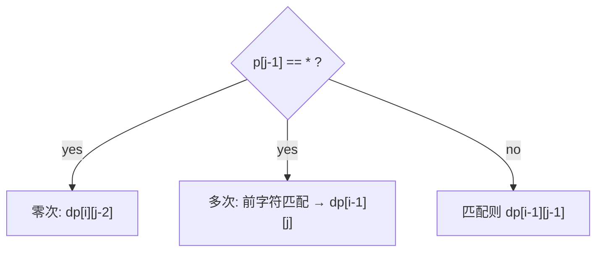

# LC 10. Regular Expression Matching

> Hard · [LeetCode](https://leetcode.com/problems/regular-expression-matching/)

## 题意

实现支持 `.` 与 `*` 的正则全串匹配。

## 最优思路

`dp[i][j]`：`s[:i]` 能否被 `p[:j]` 匹配。

- `p[j-1]` 为普通/` .`：对角线转移
- `p[j-1]=='*'`：零次用 `p[j-2]`，或一次以上要求前一字符匹配且 `dp[i-1][j]`

## 图解

## 复杂度

| 项 | 值 |
|----|----|
| 时间 | \(O(mn)\) |
| 空间 | \(O(mn)\) |
