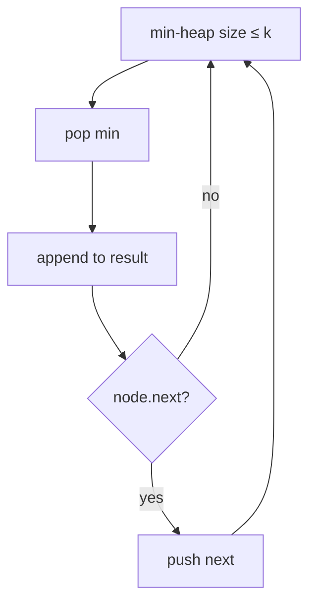

# LC 23. Merge k Sorted Lists

> Hard · [LeetCode](https://leetcode.com/problems/merge-k-sorted-lists/)

## 题意

合并 k 条升序链表成一条。

## 最优思路

最小堆存每条链表当前头；弹出最小并推进该链。总节点 N，堆大小 ≤ k。

## 图解

## 复杂度

| 项 | 值 |
|----|----|
| 时间 | \(O(N\log k)\) |
| 空间 | \(O(k)\) |
