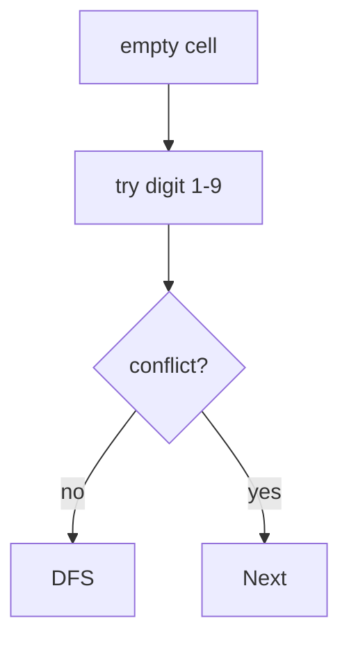

# LC 37. Sudoku Solver

> Hard · [LeetCode](https://leetcode.com/problems/sudoku-solver/)

## 题意

原地解 9×9 数独。

## 最优思路

回溯填空格；行/列/宫用 bitmask 记录已用数字，快速判冲突。

## 图解

## 复杂度

| 项 | 值 |
|----|----|
| 时间 | 指数（强剪枝） |
| 空间 | \(O(1)\) 额外（不含递归） |
