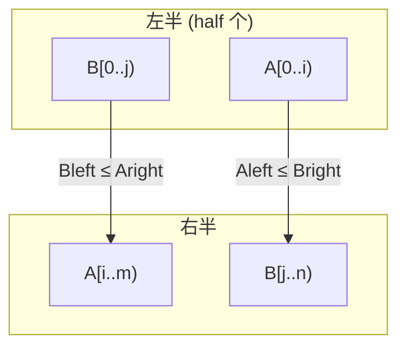

# LC 4. Median of Two Sorted Arrays

> Hard · [LeetCode](https://leetcode.com/problems/median-of-two-sorted-arrays/) · Tags: Array, Binary Search, Divide and Conquer

## 题意

给定两个**已排序**数组，求合并后的中位数；要求时间复杂度 \(O(\log(m+n))\)。

## 最优思路

在较短数组上二分「切割位置」\(i\)，令另一数组切割 \(j = \frac{m+n+1}{2}-i\)，使左半总长恰好为 half。合法条件：

- `A[i-1] ≤ B[j]` 且 `B[j-1] ≤ A[i]`

奇数取左半最大值；偶数取 `(左最大 + 右最小) / 2`。

## 图解



```text
A:  … Aleft | Aright …
B:  … Bleft | Bright …
        ↑ cut
```

## 复杂度

| 项 | 值 |
|----|----|
| 时间 | \(O(\log\min(m,n))\) |
| 空间 | \(O(1)\) |

## 代码

见 `4.median-of-two-sorted-arrays.py`。
