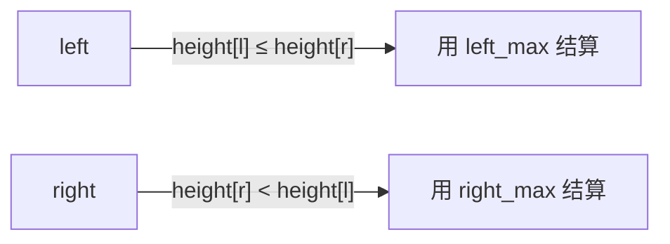

# LC 42. Trapping Rain Water

> Hard · [LeetCode](https://leetcode.com/problems/trapping-rain-water/) · Tags: Array, Two Pointers, Stack

## 题意

柱状图高度数组，求能接多少雨水。

## 最优思路

双指针：某格水量 = `min(左最高, 右最高) - height[i]`。维护 `left_max/right_max`，每次处理较矮一侧（该侧水位已被对侧「托住」）。

## 图解



```text
height: 0 1 0 2 1 0 1 3 2 1 2 1
water:    . 1 . . 1 2 1 . . 1 . .
          = 6
```

## 复杂度

| 项 | 值 |
|----|----|
| 时间 | \(O(n)\) |
| 空间 | \(O(1)\) |
