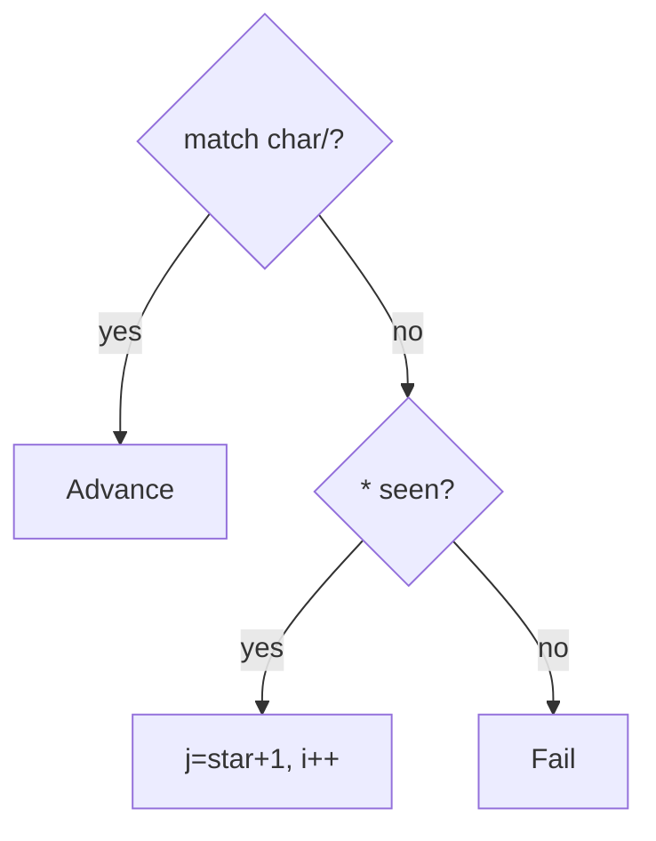

# LC 44. Wildcard Matching

> Hard · [LeetCode](https://leetcode.com/problems/wildcard-matching/)

## 题意

`?` 匹配单字符，`*` 匹配任意序列（含空）。

## 最优思路

贪心：记录最近 `*` 位置；匹配失败则回退让 `*` 多吃一个字符。

## 图解

## 复杂度

| 项 | 值 |
|----|----|
| 时间 | 最坏 \(O(mn)\) |
| 空间 | \(O(1)\) |
