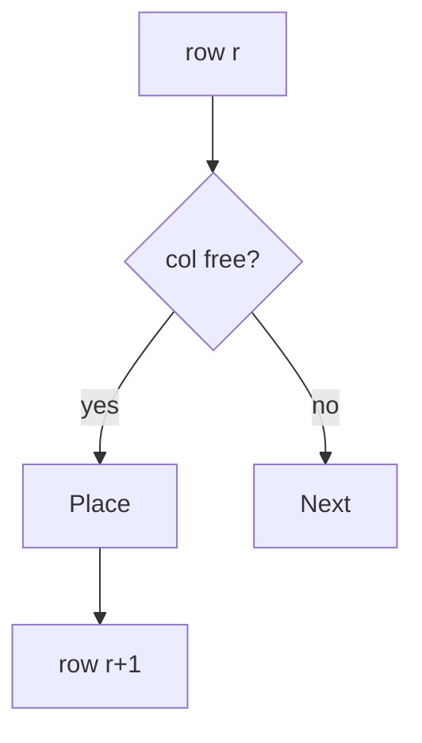

# LC 51. N-Queens

> Hard · [LeetCode](https://leetcode.com/problems/n-queens/)

## 题意

在 n×n 棋盘放 n 个皇后，互不攻击，返回所有棋盘布局。

## 最优思路

按行回溯；用列、主对角 `r-c`、副对角 `r+c` 集合剪枝。

## 图解

```text
n=4 一种解:
.Q..
...Q
Q...
..Q.
```



## 复杂度

| 项 | 值 |
|----|----|
| 时间 | \(O(n!)\) |
| 空间 | \(O(n)\) |
