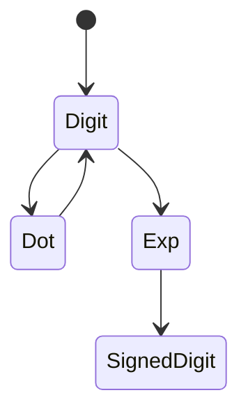

# LC 65. Valid Number

> Hard · [LeetCode](https://leetcode.com/problems/valid-number/)

## 题意

判断字符串是否为合法数字（含小数、指数）。

## 最优思路

扫描状态：是否已见数字/小数点/指数；`+/-` 只允许开头或 `e/E` 后。

## 图解

## 复杂度

| 项 | 值 |
|----|----|
| 时间 | \(O(n)\) |
| 空间 | \(O(1)\) |
