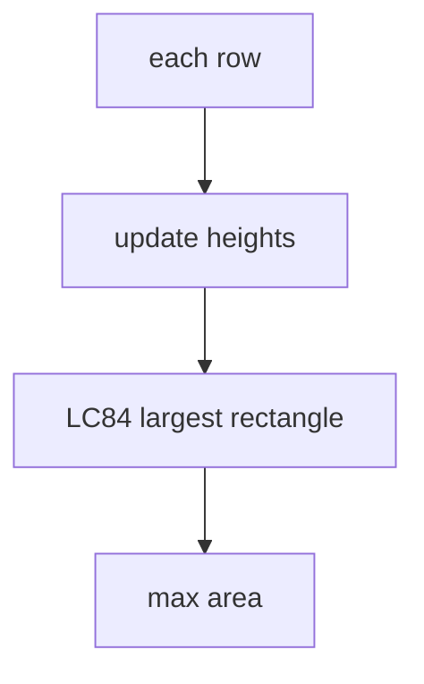

# LC 85. Maximal Rectangle

> Hard · [LeetCode](https://leetcode.com/problems/maximal-rectangle/)

## 题意

`'0'/'1'` 矩阵中全 1 最大矩形面积。

## 最优思路

逐行把连续 1 堆成柱高，对每行做「直方图最大矩形」(LC 84)。

## 图解

## 复杂度

| 项 | 值 |
|----|----|
| 时间 | \(O(RC)\) |
| 空间 | \(O(C)\) |
