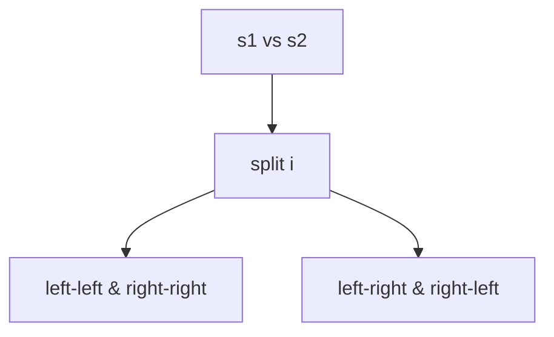

# LC 87. Scramble String

> Hard · [LeetCode](https://leetcode.com/problems/scramble-string/)

## 题意

判断 `s2` 是否为 `s1` 的扰乱字符串。

## 最优思路

记忆化：枚举切割点；不交换 / 交换两子串两种情况；字符计数剪枝。

## 图解

## 复杂度

| 项 | 值 |
|----|----|
| 时间 | \(O(n^4)\) 量级 |
| 空间 | \(O(n^3)\) 状态 |
