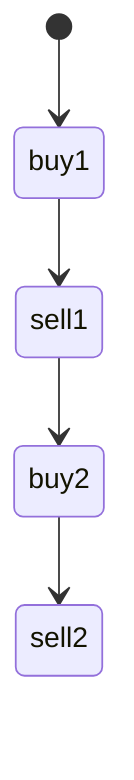

# LC 123. Best Time to Buy and Sell Stock III

> Hard · [LeetCode](https://leetcode.com/problems/best-time-to-buy-and-sell-stock-iii/)

## 题意

最多两笔交易的最大利润。

## 最优思路

状态机：`buy1 → sell1 → buy2 → sell2` 滚动更新。

## 图解

## 复杂度

| 项 | 值 |
|----|----|
| 时间 | \(O(n)\) |
| 空间 | \(O(1)\) |
