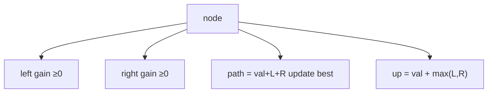

# LC 124. Binary Tree Maximum Path Sum

> Hard · [LeetCode](https://leetcode.com/problems/binary-tree-maximum-path-sum/)

## 题意

二叉树任意路径（可不经根）的最大节点值和。

## 最优思路

后序：对父贡献 `val + max(左,右,0)`；同时用 `val+左+右` 更新全局最优路径。

## 图解

## 复杂度

| 项 | 值 |
|----|----|
| 时间 | \(O(n)\) |
| 空间 | \(O(h)\) |
