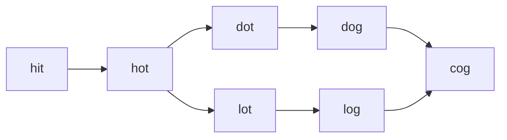

# LC 126. Word Ladder II

> Hard · [LeetCode](https://leetcode.com/problems/word-ladder-ii/)

## 题意

返回所有最短单词梯路径。

## 最优思路

BFS 按层建 `parents`；到达 `endWord` 后从终点 DFS 回溯所有最短路。

## 图解

## 复杂度

| 项 | 值 |
|----|----|
| 时间 | 与图大小/路径数相关 |
| 空间 | 同左 |
