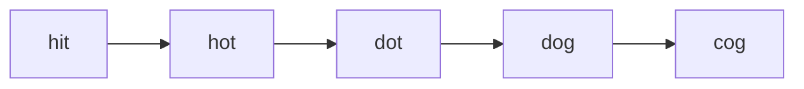

# LC 127. Word Ladder

> Hard · [LeetCode](https://leetcode.com/problems/word-ladder/)

## 题意

每次改一个字母，最短变换序列长度（含起终点）。

## 最优思路

BFS；邻居枚举 26 字母；访问过即从集合删除。

## 图解

## 复杂度

| 项 | 值 |
|----|----|
| 时间 | \(O(N\cdot L\cdot 26)\) |
| 空间 | \(O(N)\) |
