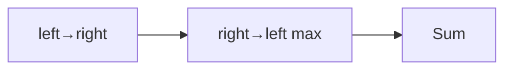

# LC 135. Candy

> Hard · [LeetCode](https://leetcode.com/problems/candy/)

## 题意

按评分发糖：相邻高分必须更多；最少总数。

## 最优思路

左右各扫一遍：先满足左邻约束，再取 max 满足右邻。

## 图解

## 复杂度

| 项 | 值 |
|----|----|
| 时间 | \(O(n)\) |
| 空间 | \(O(n)\) |
