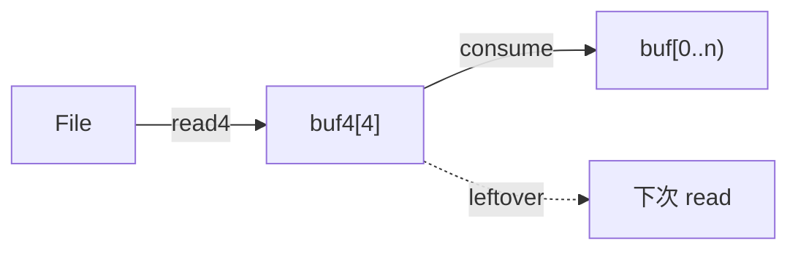

# LC 158. Read N Characters Given read4 II - Call Multiple Times

> Hard · [LeetCode](https://leetcode.com/problems/read-n-characters-given-read4-ii-call-multiple-times/) · Tags: Array, Simulation, Interactive

## 题意

给定 API `read4(buf4)` 每次最多读 4 个字符。实现 `read(buf, n)`，可被**多次调用**，累计正确读出文件内容（上次未用完的字符要保留）。

## 最优思路

维护内部缓冲区 `_buf4` 及指针 `_i4/_n4`：

1. 需要字符时，若缓冲耗尽则再调 `read4`
2. 从缓冲拷到 `buf`，直到凑满 `n` 或文件结束
3. 残留字符留在实例中供下次 `read` 使用

## 图解



```text
file: a b c d e f g ...
      └─read4─┘
read(3) → a b c   leftover: d
read(2) → d e     leftover: (empty, next read4)
```

## 复杂度

| 项 | 值 |
|----|----|
| 时间 | \(O(n)\)（每次 read） |
| 空间 | \(O(1)\) 额外缓冲 |

## 代码

见 `158.read-n-characters-given-read4-ii-call-multiple-times.py`。
