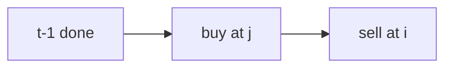

# LC 188. Best Time to Buy and Sell Stock IV

> Hard · [LeetCode](https://leetcode.com/problems/best-time-to-buy-and-sell-stock-iv/)

## 题意

最多 k 笔交易的最大利润。

## 最优思路

`dp[t][i]`：至多 t 笔、到第 i 天。滚动 `max_diff = dp[t-1][j]-prices[j]`。`k≥n/2` 退化为无限次。

## 图解

## 复杂度

| 项 | 值 |
|----|----|
| 时间 | \(O(kn)\) |
| 空间 | \(O(kn)\) |
