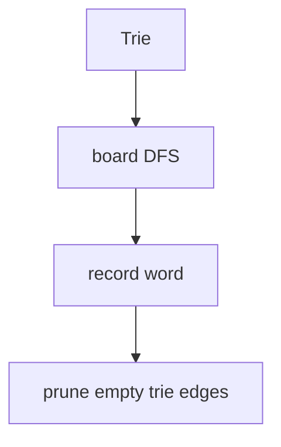

# LC 212. Word Search II

> Hard · [LeetCode](https://leetcode.com/problems/word-search-ii/)

## 题意

在字符网格中找字典里出现的所有单词。

## 最优思路

建 Trie；网格 DFS 沿 Trie 走；找到单词后清空标记；无子节点则剪枝删边。

## 图解

## 复杂度

| 项 | 值 |
|----|----|
| 时间 | \(O(MN\cdot 4^L)\) 量级 |
| 空间 | Trie + 递归 |
