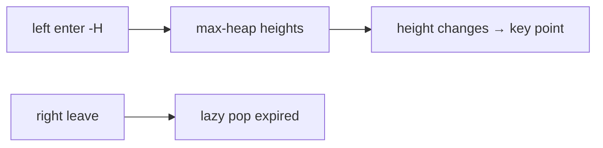

# LC 218. The Skyline Problem

> Hard · [LeetCode](https://leetcode.com/problems/the-skyline-problem/)

## 题意

根据矩形建筑输出天际线关键点。

## 最优思路

扫描线：左端点插入高度，右端点删除；高度变化处记录关键点。大根堆 + 懒删除过期右边界。

## 图解

## 复杂度

| 项 | 值 |
|----|----|
| 时间 | \(O(n\log n)\) |
| 空间 | \(O(n)\) |
