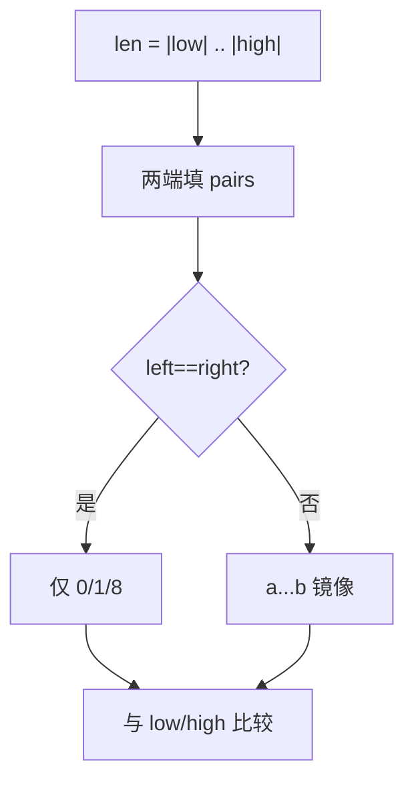

# LC 248. Strobogrammatic Number III

> Hard · [LeetCode](https://leetcode.com/problems/strobogrammatic-number-iii/) · Tags: Array, String, Recursion

## 题意

统计区间 `[low, high]`（字符串表示的大整数）内有多少个**中心对称数**（旋转 180° 后仍是同一数字）：可用数字对 `0-0, 1-1, 6-9, 8-8, 9-6`。

## 最优思路

按长度从 `len(low)` 到 `len(high)` 做 DFS：从两端向中间填镜像对；奇数长度中间只能填自对称字符。生成后与 `low/high` 做字符串比较，并排除前导零。

## 图解



```text
长度 2: 11, 69, 88, 96  (00 因前导零丢弃)
[50,100] → 69, 88, 96
```

## 复杂度

| 项 | 值 |
|----|----|
| 时间 | \(O(5^{L/2})\)，\(L=|high|\) |
| 空间 | \(O(L)\) 递归栈 |

## 代码

见 `248.strobogrammatic-number-iii.py`。
