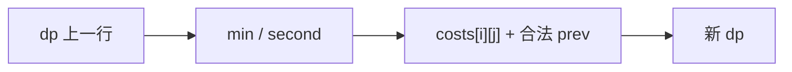

# LC 265. Paint House II

> Hard · [LeetCode](https://leetcode.com/problems/paint-house-ii/) · Tags: Array, Dynamic Programming

## 题意

`n` 栋房子、`k` 种颜色，`costs[i][j]` 为第 `i` 房涂色 `j` 的代价。相邻房颜色不能相同，求最小总代价。

## 最优思路

滚动 DP：对每一行只需上一行的**最小代价**与**次小代价**（及最小对应颜色）。当前颜色若等于上一行最小色则用次小，否则用最小 → 每房 \(O(k)\)。

## 图解



```text
costs:  1 5 3
        2 9 4
房0 选1 → 房1 只能 4 → 总 5
```

## 复杂度

| 项 | 值 |
|----|----|
| 时间 | \(O(nk)\) |
| 空间 | \(O(k)\) |

## 代码

见 `265.paint-house-ii.py`。
