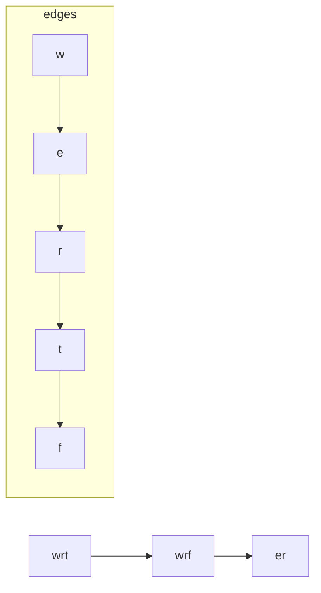

# LC 269. Alien Dictionary

> Hard · [LeetCode](https://leetcode.com/problems/alien-dictionary/) · Tags: Array, String, Graph, Topological Sort

## 题意

给定按外星字典序排序的单词列表，推导字母顺序；若有多种合法序返回任意一种，非法/有环返回 `""`。

## 最优思路

比较**相邻**两词找第一处不同字符，建有向边 `a → b`（a 在 b 前）。再 Kahn 拓扑排序；检测前缀非法（长词前缀等于短词）。

## 图解



```text
wrt < wrf  → t→f
wrf < er   → w→e
er  < ett  → r→t
ett < rftt → e→r
拓扑: w e r t f
```

## 复杂度

| 项 | 值 |
|----|----|
| 时间 | \(O(C)\)，\(C\) 为总字符数 |
| 空间 | \(O(1)\) 字母表 + 边 |

## 代码

见 `269.alien-dictionary.py`。
