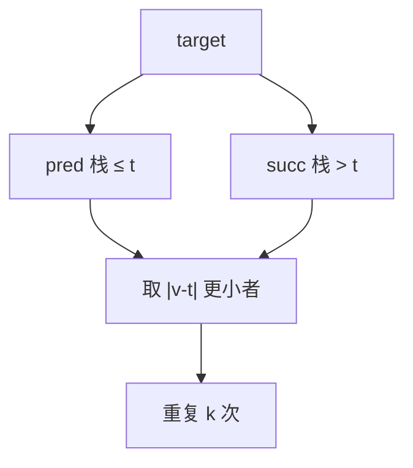

# LC 272. Closest Binary Search Tree Value II

> Hard · [LeetCode](https://leetcode.com/problems/closest-binary-search-tree-value-ii/) · Tags: Tree, BST, Stack, Two Pointers

## 题意

在 BST 中找与 `target` 最接近的 `k` 个节点值（任意顺序返回即可）。

## 最优思路

维护两个栈：`pred`（≤ target 的路径，模拟中序反向）、`succ`（> target 的路径）。每次取更近一侧弹出，并沿子树推进，共取 `k` 次 → \(O(k+h)\)。

## 图解



```text
    4
   / \
  2   5
 / \
1   3   target≈3.71 → pred:3,4  succ:5 → 取 4,3
```

## 复杂度

| 项 | 值 |
|----|----|
| 时间 | \(O(k + h)\) |
| 空间 | \(O(h)\) |

## 代码

见 `272.closest-binary-search-tree-value-ii.py`。
