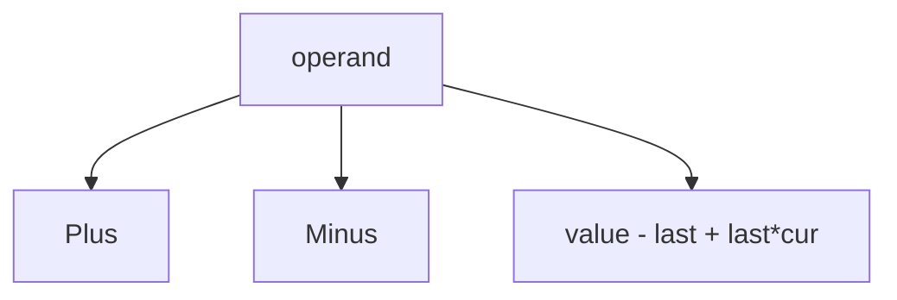

# LC 282. Expression Add Operators

> Hard · [LeetCode](https://leetcode.com/problems/expression-add-operators/)

## 题意

在数字串间加 `+ - *`，使表达式等于 target。

## 最优思路

DFS 枚举切分；维护当前值与上一段操作数，乘法用 `value - last + last * cur`。

## 图解

## 复杂度

| 项 | 值 |
|----|----|
| 时间 | \(O(4^n)\) 量级 |
| 空间 | \(O(n)\) |
