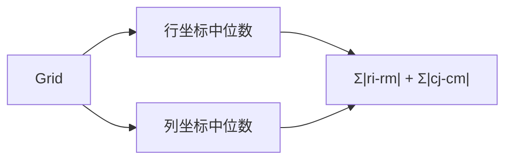

# LC 296. Best Meeting Point

> Hard · [LeetCode](https://leetcode.com/problems/best-meeting-point/) · Tags: Array, Math, Sorting, Matrix

## 题意

网格中 `1` 为朋友位置，选一点使所有人到该点的**曼哈顿距离之和**最小。

## 最优思路

曼哈顿距离可拆成行、列独立。一维上最优汇合点是**中位数**。分别收集行坐标（按行扫描已有序）与列坐标（按列扫描），对中位数求和。

## 图解



```text
1 . . . 1
. . . . .
. . 1 . .
中位行=0或2? 有序 [0,0,2] 中位 0 → 距离 0+0+2=2
列 [0,4,2] 有序 [0,2,4] 中位 2 → 2+2+0=4  总 6
```

## 复杂度

| 项 | 值 |
|----|----|
| 时间 | \(O(mn)\) |
| 空间 | \(O(p)\)，\(p\) 为人数 |

## 代码

见 `296.best-meeting-point.py`。
