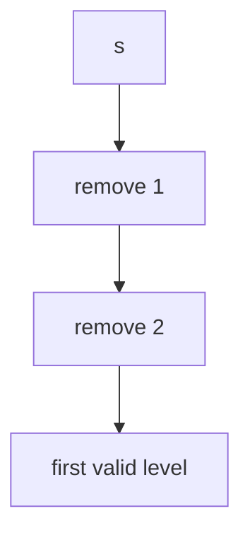

# LC 301. Remove Invalid Parentheses

> Hard · [LeetCode](https://leetcode.com/problems/remove-invalid-parentheses/)

## 题意

删最少括号使合法，返回所有可能结果。

## 最优思路

BFS：每层删一个括号；首次出现合法串的那层即为最少删除。

## 图解

## 复杂度

| 项 | 值 |
|----|----|
| 时间 | 指数级，但按最少删除层停止 |
| 空间 | 同左 |
