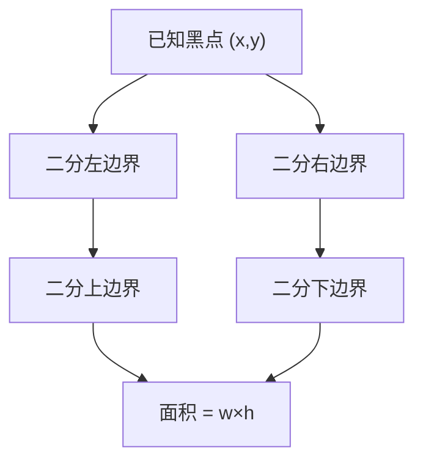

# LC 302. Smallest Rectangle Enclosing Black Pixels

> Hard · [LeetCode](https://leetcode.com/problems/smallest-rectangle-enclosing-black-pixels/) · Tags: Array, Binary Search, Matrix

## 题意

二值图像中黑色像素 `'1'` 连通，给定一个黑点坐标，求包住所有黑像素的最小轴对齐矩形面积。

## 最优思路

已知连通且给了内部一点，对四条边界分别二分：列是否含黑、行是否含黑，得到 `[left,right) × [top,bottom)`。

## 图解



```text
0 0 1 0
0 1 1 0
0 1 0 0
矩形列 [1,3) 行 [0,3) → 2×3 = 6
```

## 复杂度

| 项 | 值 |
|----|----|
| 时间 | \(O(m\log n + n\log m)\) |
| 空间 | \(O(1)\) |

## 代码

见 `302.smallest-rectangle-enclosing-black-pixels.py`。
