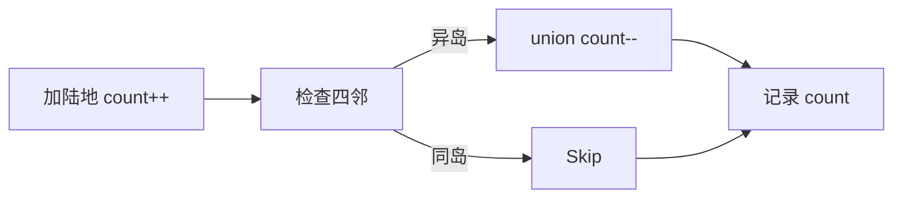

# LC 305. Number of Islands II

> Hard · [LeetCode](https://leetcode.com/problems/number-of-islands-ii/) · Tags: Array, Union-Find

## 题意

`m×n` 初始全水，按序列将位置填成陆地，每次操作后返回当前岛屿数量。

## 最优思路

并查集：新陆地 `count++`，再与四邻已有陆地 `union`（每次合并 `count--`）。重复位置直接沿用当前 count。

## 图解



```text
(0,0)→1  (0,1)合并→1  (1,2)→2  (2,1)→3
```

## 复杂度

| 项 | 值 |
|----|----|
| 时间 | \(O(k\,\alpha(mn))\) |
| 空间 | \(O(mn)\) |

## 代码

见 `305.number-of-islands-ii.py`。
