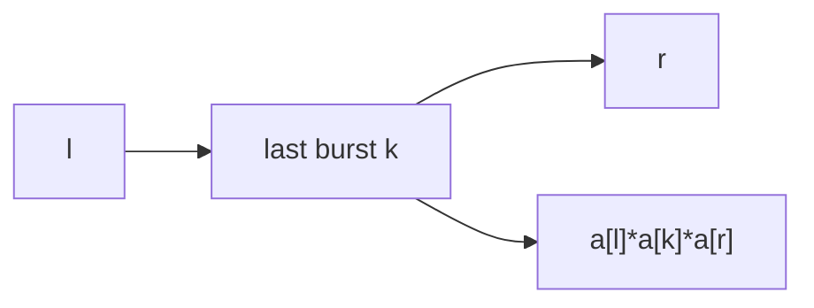

# LC 312. Burst Balloons

> Hard · [LeetCode](https://leetcode.com/problems/burst-balloons/)

## 题意

戳气球得分 `左邻*自己*右邻`，求最大总分。

## 最优思路

区间 DP：枚举开区间 `(l,r)` 内最后戳破的 `k`，转移  
`dp[l][r] = max(dp[l][k] + a[l]*a[k]*a[r] + dp[k][r])`。两端补 1。

## 图解

## 复杂度

| 项 | 值 |
|----|----|
| 时间 | \(O(n^3)\) |
| 空间 | \(O(n^2)\) |
