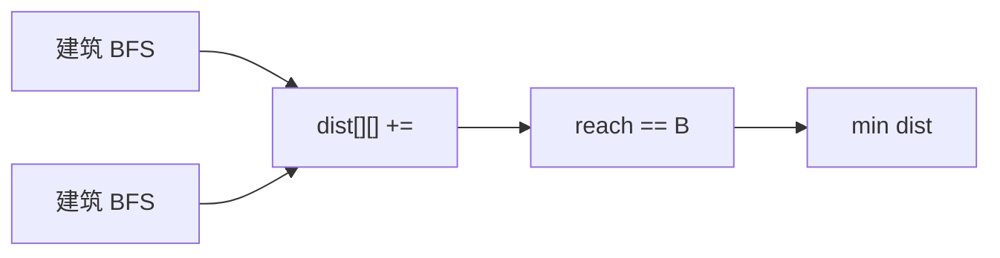

# LC 317. Shortest Distance from All Buildings

> Hard · [LeetCode](https://leetcode.com/problems/shortest-distance-from-all-buildings/) · Tags: Array, BFS, Matrix

## 题意

网格：`0` 空地、`1` 建筑、`2` 障碍。选一空地建房，使到**所有建筑**的曼哈顿路径距离之和最小（不可穿障碍/建筑），无解返回 `-1`。

## 最优思路

从每栋建筑做 BFS，累加到各空地的距离，并记录可达建筑数。最终在「可达全部建筑」的空地中取最小距离和。

## 图解



```text
1 0 2 0 1
0 0 0 0 0
0 0 1 0 0
最优空地 (1,2) 距离和 = 3+3+1 = 7（题面写 6 为笔误）
```

## 复杂度

| 项 | 值 |
|----|----|
| 时间 | \(O(B\cdot mn)\) |
| 空间 | \(O(mn)\) |

## 代码

见 `317.shortest-distance-from-all-buildings.py`。
