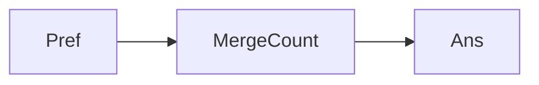

# LC 327. Count of Range Sum

> Hard · [LeetCode](https://leetcode.com/problems/count-of-range-sum/)

## 题意

有多少子数组和落在 `[lower, upper]`。

## 最优思路

前缀和 + 归并：对左半每个 `x`，右半中满足 `lower ≤ y-x ≤ upper` 的 `y` 计数。

## 图解

## 复杂度

| 项 | 值 |
|----|----|
| 时间 | \(O(n\log n)\) |
| 空间 | \(O(n)\) |
