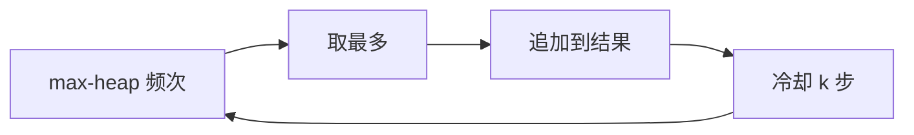

# LC 358. Rearrange String k Distance Apart

> Hard · [LeetCode](https://leetcode.com/problems/rearrange-string-k-distance-apart/) · Tags: Hash Table, Greedy, Heap

## 题意

重排字符串，使相同字符间距至少为 `k`；不可能则返回 `""`。

## 最优思路

大根堆按剩余次数取当前最多字符；用冷却队列记录「`i+k` 后才能再用」。无可用字符且冷却未到 → 失败。

## 图解



```text
aabbcc, k=3 → 如 abcabc
aaabc, k=3 → 不可能
```

## 复杂度

| 项 | 值 |
|----|----|
| 时间 | \(O(n\log\Sigma)\)，\(\Sigma\le 26\) |
| 空间 | \(O(\Sigma)\) |

## 代码

见 `358.rearrange-string-k-distance-apart.py`。
