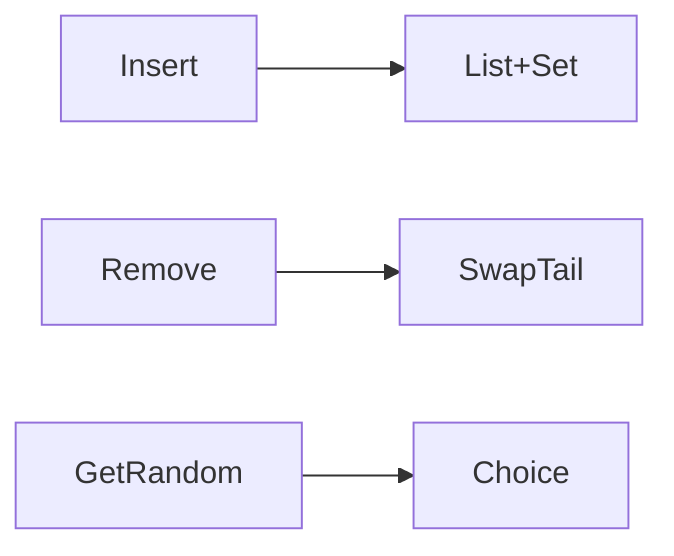

# LC 381. Insert Delete GetRandom O(1) - Duplicates allowed

> Hard · [LeetCode](https://leetcode.com/problems/insert-delete-getrandom-o1-duplicates-allowed/)

## 题意

支持重复的 Insert/Delete/GetRandom，均摊 O(1)。

## 最优思路

`list` 存值；`val→set(indices)`；删时与末尾交换。

## 图解

## 复杂度

| 项 | 值 |
|----|----|
| 各操作 | 均摊 \(O(1)\) |
