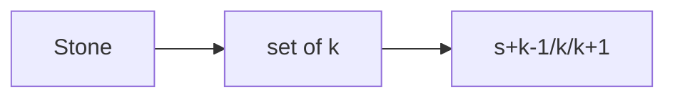

# LC 403. Frog Jump

> Hard · [LeetCode](https://leetcode.com/problems/frog-jump/)

## 题意

青蛙从第一块石按跳距 k-1/k/k+1 能否到最后。

## 最优思路

每石记录可达跳距集合；向 `s+dk` 转移。

## 图解

## 复杂度

| 项 | 值 |
|----|----|
| 时间 | \(O(n^2)\) |
| 空间 | \(O(n^2)\) |
