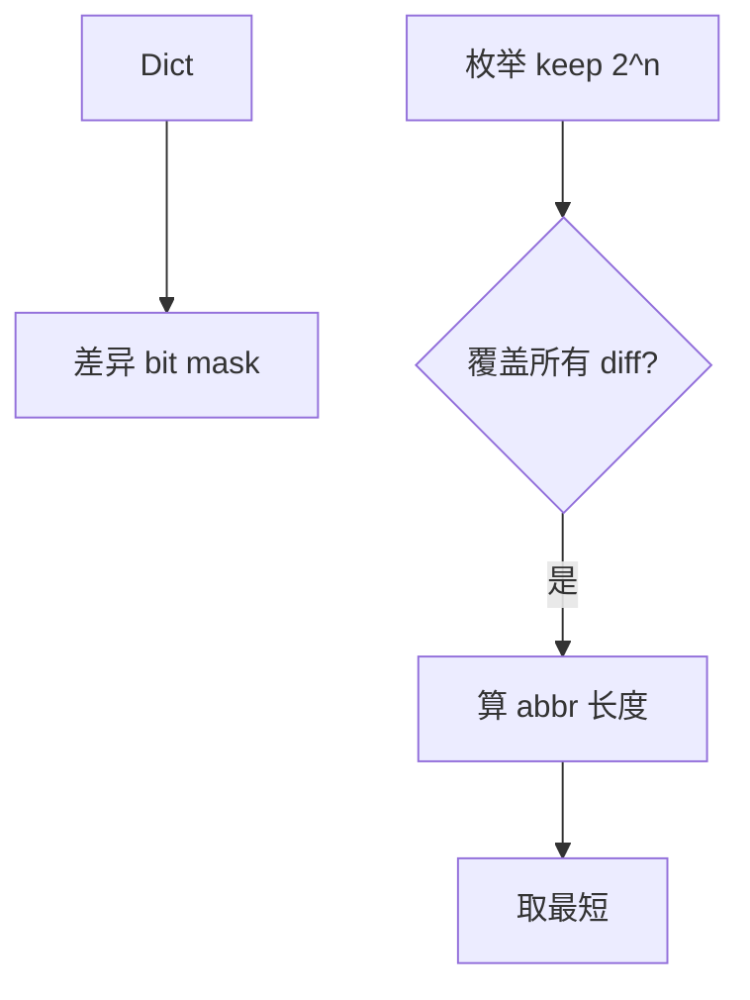

# LC 411. Minimum Unique Word Abbreviation

> Hard · [LeetCode](https://leetcode.com/problems/minimum-unique-word-abbreviation/) · Tags: Array, String, Bit Manipulation, Backtracking

## 题意

给目标词 `target` 与字典，求 `target` 的**最短缩写**，使其不与字典中任何同长词的缩写冲突（缩写规则：连续省略用数字表示）。

## 最优思路

对每个同长字典词，记录与 target 的**差异位掩码**。枚举保留掩码 `keep`：若对每个差异掩码 `d` 都有 `keep & d ≠ 0`，则该缩写可区分；在合法 `keep` 中取缩写长度最短者。

## 图解



```text
target=apple, dict=[blade]
差异位多 → keep 只留 a → "a4"
```

## 复杂度

| 项 | 值 |
|----|----|
| 时间 | \(O(2^n \cdot m \cdot n)\) |
| 空间 | \(O(m)\) |

## 代码

见 `411.minimum-unique-word-abbreviation.py`。
