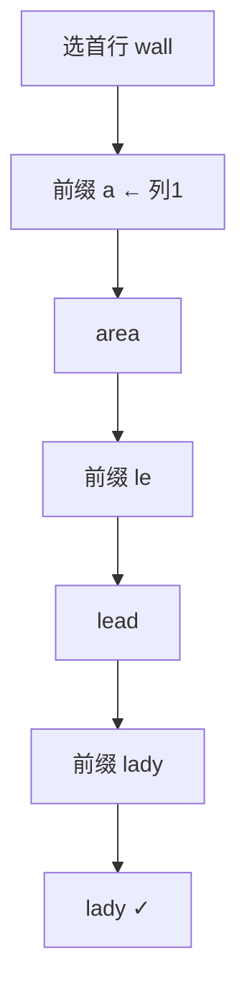

# LC 425. Word Squares

> Hard · [LeetCode](https://leetcode.com/problems/word-squares/) · Tags: Array, String, Backtracking, Trie

## 题意

给定等长单词表，找出所有**单词方阵**：第 `i` 行等于第 `i` 列读出的字符串。

## 最优思路

预处理所有前缀 → 单词列表。回溯填行：第 `k` 行的前缀由已填行的第 `k` 列字符拼接决定，再从前缀表取候选。

## 图解



```text
b a l l
a r e a
l e a d
l a d y
```

## 复杂度

| 项 | 值 |
|----|----|
| 时间 | 与解数量相关，前缀加速剪枝 |
| 空间 | \(O(N\cdot L)\) 前缀表 |

## 代码

见 `425.word-squares.py`。
