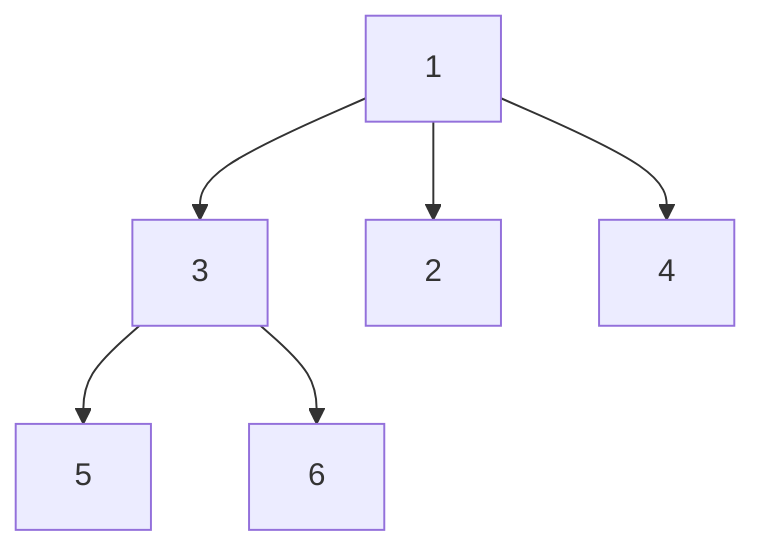

# LC 428. Serialize and Deserialize N-ary Tree

> Hard · [LeetCode](https://leetcode.com/problems/serialize-and-deserialize-n-ary-tree/) · Tags: String, Tree, DFS, BFS

## 题意

设计 N 叉树的序列化/反序列化（类似 LC 297）。

## 最优思路

前序遍历：输出 `val, childCount`，再递归子节点。反序列化按同样顺序消费数组即可，无需哨兵空节点。

## 图解



```text
序列: 1,3, 3,2, 5,0, 6,0, 2,0, 4,0
```

## 复杂度

| 项 | 值 |
|----|----|
| 时间 | \(O(n)\) |
| 空间 | \(O(n)\) |

## 代码

见 `428.serialize-and-deserialize-n-ary-tree.py`。
