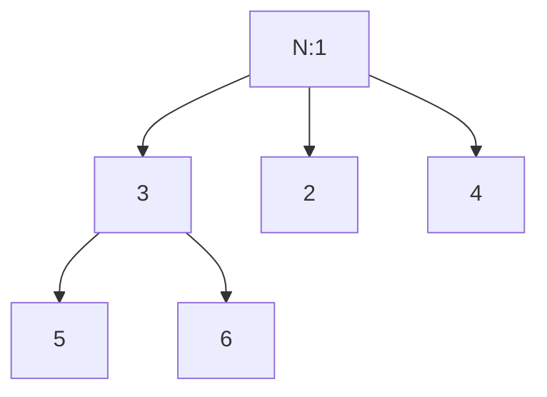

# LC 431. Encode N-ary Tree to Binary Tree

> Hard · [LeetCode](https://leetcode.com/problems/encode-n-ary-tree-to-binary-tree/) · Tags: Tree, Design, Binary Tree

## 题意

把 N 叉树编码为二叉树，并能无损解码回来。

## 最优思路

**左孩子-右兄弟**：N 叉节点的第一个孩子 → 二叉树左子；其余孩子串在左子的右链上。

## 图解



```text
二叉树:
      1
     /
    3
   / \
  5   2
   \   \
    6   4
```

## 复杂度

| 项 | 值 |
|----|----|
| 时间 | \(O(n)\) |
| 空间 | \(O(h)\) 递归 |

## 代码

见 `431.encode-n-ary-tree-to-binary-tree.py`。
