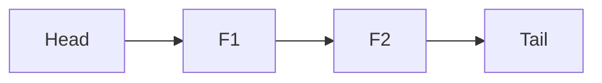

# LC 432. All O`one Data Structure

> Hard · [LeetCode](https://leetcode.com/problems/all-oone-data-structure/)

## 题意

字符串计数结构：inc/dec/getMaxKey/getMinKey 全 O(1)。

## 最优思路

频次双向链表桶 + key→桶；inc/dec 在相邻桶间移动。

## 图解

## 复杂度

| 项 | 值 |
|----|----|
| 各操作 | \(O(1)\) |
