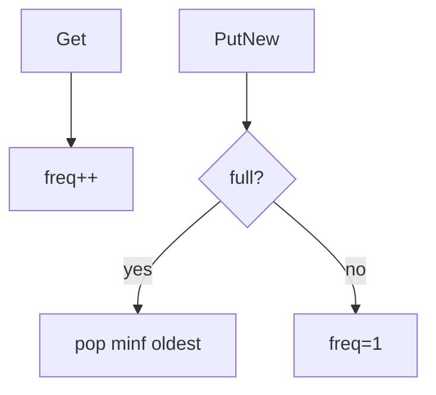

# LC 460. LFU Cache

> Hard · [LeetCode](https://leetcode.com/problems/lfu-cache/)

## 题意

实现 LFU；同频淘汰最久未使用。

## 最优思路

`key → (val, freq)` + `freq → OrderedDict(keys)`；维护 `minf`。访问时从旧频移到新频。

## 图解

## 复杂度

| 项 | 值 |
|----|----|
| get/put | \(O(1)\) 摊还 |
