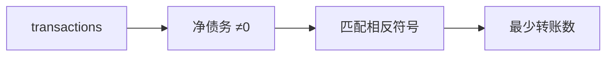

# LC 465. Optimal Account Balancing

> Hard · [LeetCode](https://leetcode.com/problems/optimal-account-balancing/) · Tags: Array, DP, Backtracking, Bitmask

## 题意

若干转账 `(from, to, amount)` 后，用最少笔额外转账使所有人余额归零。

## 最优思路

先算净债务，去掉为 0 的人。对非零债务数组 DFS：从第一个未清账户出发，找符号相反者做一笔转账（把当前债务加到对方），递归；回溯。完全抵消时可剪枝。

## 图解



```text
0→1:10, 1→0:1, 1→2:5, 2→0:5
净债务清算最少 1 笔转账
```

## 复杂度

| 项 | 值 |
|----|----|
| 时间 | \(O(n!)\) 最坏，剪枝后可接受（\(n\le 12\)） |
| 空间 | \(O(n)\) |

## 代码

见 `465.optimal-account-balancing.py`。
