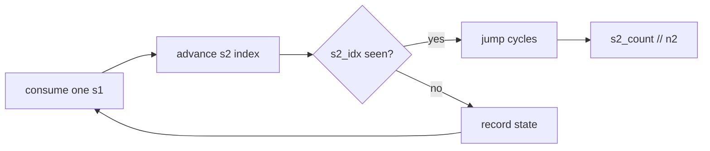

# LC 466. Count The Repetitions

> Hard · [LeetCode](https://leetcode.com/problems/count-the-repetitions/) · Tags: Two Pointers, String, Dynamic Programming

## 题意

定义 `[s, n]` 为字符串 `s` 重复 `n` 次。求最大整数 `m`，使得 `[s2, n2 * m]` 是 `[s1, n1]` 的子序列。

## 最优思路

逐块消耗 `s1`，记录「当前匹配到 `s2` 的下标」→（已用 `s1` 块数，已完成 `s2` 次数）。若同一 `s2` 下标再次出现，说明进入循环，可整段跳跃剩余 `s1` 块，最后答案为 `s2_count // n2`。

## 图解



```text
s1 blocks:  [s1][s1][s1]...[s1]
matching:    →→  →→  ⟳ cycle  →→
s2 count:    +1  +2  +2*k ...
```

## 复杂度

| 项 | 值 |
|----|----|
| 时间 | \(O(|s1|\cdot|s2|)\)（找到环后跳跃） |
| 空间 | \(O(|s2|)\) |

## 代码

见 `466.count-the-repetitions.py`。
