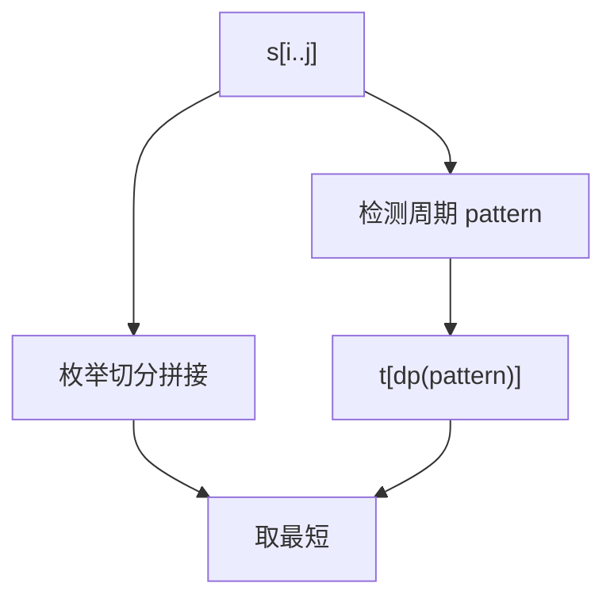

# LC 471. Encode String with Shortest Length

> Hard · [LeetCode](https://leetcode.com/problems/encode-string-with-shortest-length/) · Tags: String, Dynamic Programming

## 题意

将字符串编码为最短形式：`k[encoded_string]` 表示 `encoded_string` 重复 `k` 次；可嵌套。返回最短编码（并列时任意）。

## 最优思路

区间 DP：`dp[i][j]` = `s[i..j]` 的最短编码。转移：

1. 枚举切分点拼接 `dp[i][k]+dp[k+1][j]`
2. 用 `(s+s).find(s,1)` 找最小周期，若 `s = pattern * t`，候选 `t[encode(pattern)]`

长度 ≤4 时编码不会更短，直接保留原文。

## 图解



```text
aaaaa     → 5[a]
aabcaabcd → 2[aabc]d
abbbabbbcabbbabbbc → 2[2[abbb]c]
```

## 复杂度

| 项 | 值 |
|----|----|
| 时间 | \(O(n^3)\) |
| 空间 | \(O(n^2)\) |

## 代码

见 `471.encode-string-with-shortest-length.py`。
