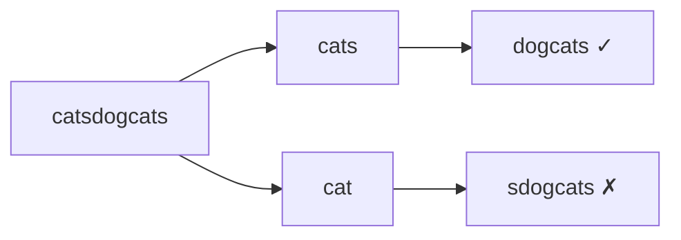

# LC 472. Concatenated Words

> Hard · [LeetCode](https://leetcode.com/problems/concatenated-words/) · Tags: Array, String, DP, DFS, Trie

## 题意

给定无重复单词表，找出所有「至少由字典中两个更短单词拼接而成」的词。

## 最优思路

把全部词放入集合，对每个词做记忆化拆分：枚举前缀，若前缀在字典且后缀也在字典或可继续拆分，则为拼接词。等价于 Word Break，且必须至少拆两段。

## 图解



```text
word_set = {cat, cats, dog, ...}
catsdogcats = cats + dog + cats  → 拼接词
```

## 复杂度

| 项 | 值 |
|----|----|
| 时间 | \(O(\sum L_i^2)\) |
| 空间 | \(O(\sum L_i)\) |

## 代码

见 `472.concatenated-words.py`。
