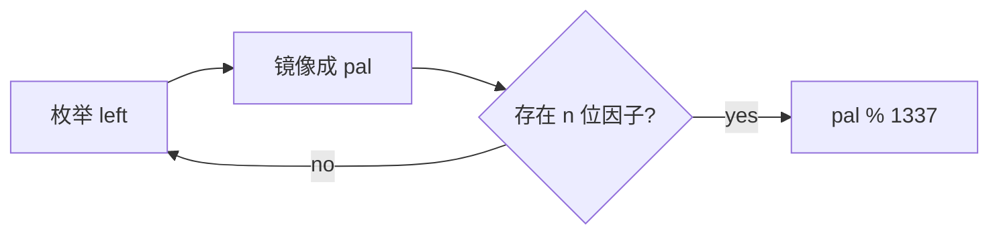

# LC 479. Largest Palindrome Product

> Hard · [LeetCode](https://leetcode.com/problems/largest-palindrome-product/) · Tags: Math

## 题意

求两个 `n` 位数乘积能形成的最大回文数，返回该回文数对 1337 取模。

## 最优思路

从大到小枚举回文左半部分，镜像生成候选回文 `pal`，再从大到小检查是否存在 `n` 位因子 `a` 使 `pal % a == 0` 且另一因子也是 `n` 位。`n=1` 特判为 9。

## 图解

```text
n=2: left=99 → pal=9999  (无)
     left=98 → pal=9889  (无)
     ...
     left=91 → pal=9009 = 91×99 ✓ → 9009 % 1337 = 987
```



## 复杂度

| 项 | 值 |
|----|----|
| 时间 | \(O(10^n \cdot 10^{n/2})\) 量级（n≤8 可过） |
| 空间 | \(O(1)\) |

## 代码

见 `479.largest-palindrome-product.py`。
