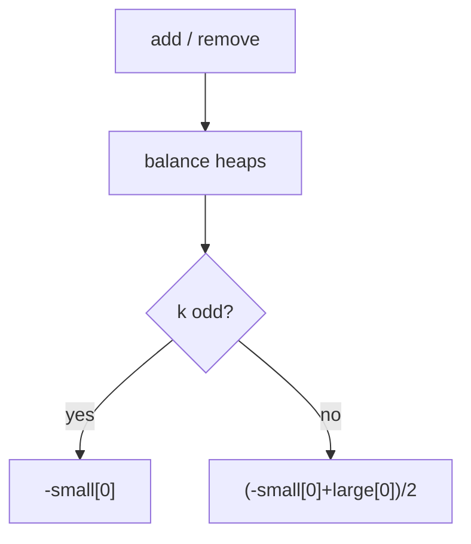

# LC 480. Sliding Window Median

> Hard · [LeetCode](https://leetcode.com/problems/sliding-window-median/) · Tags: Array, Hash Table, Sliding Window, Heap

## 题意

大小为 `k` 的滑动窗口扫过数组，返回每个窗口的中位数。

## 最优思路

对顶堆：`small`（大根堆）存较小一半，`large`（小根堆）存较大一半。惰性删除：窗口滑出时标记延迟删，堆顶再真正弹出。保持 `len(small) == len(large)` 或 `len(small) = len(large)+1`。

## 图解

```text
窗口 [1,3,-1]  k=3
small: 1        large: 3,-1 → 平衡后 small:1  large:3 / -1→…
中位 = small.top
```



## 复杂度

| 项 | 值 |
|----|----|
| 时间 | \(O(n\log k)\) |
| 空间 | \(O(k)\) |

## 代码

见 `480.sliding-window-median.py`。
