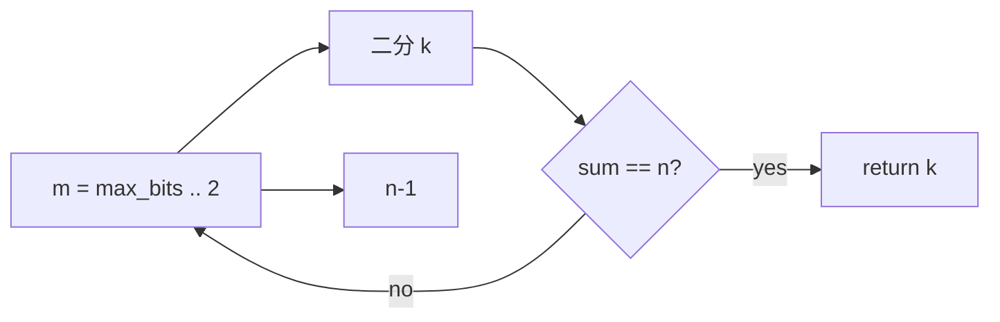

# LC 483. Smallest Good Base

> Hard · [LeetCode](https://leetcode.com/problems/smallest-good-base/) · Tags: Math, Binary Search

## 题意

给定整数字符串 `n`，找最小进制 `k≥2`，使 `n` 在该进制下全为 1（形如 `111…1`）。

## 最优思路

即 \(n = (k^m-1)/(k-1)\)。`m` 从最大可能位数降到 2；对每个 `m` 二分搜索 `k`。若无解则答案为 `n-1`（`11` 在进制 `n-1`）。

## 图解

```text
n=13 → 111 in base 3: 1+3+9=13 ✓  → "3"
n=4681 → 11111 in base 8
```



## 复杂度

| 项 | 值 |
|----|----|
| 时间 | \(O(\log n \cdot 64)\) |
| 空间 | \(O(1)\) |

## 代码

见 `483.smallest-good-base.py`。
