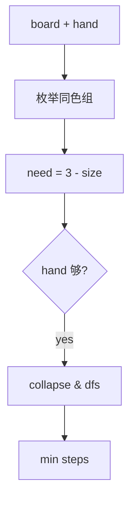

# LC 488. Zuma Game

> Hard · [LeetCode](https://leetcode.com/problems/zuma-game/) · Tags: String, DP, BFS, Memoization

## 题意

祖玛：手上有球，往棋盘连续同色段插入，使该段达 ≥3 即消除并可连锁。求清空棋盘最少用球数；不可能返回 -1。

## 最优思路

对每种连续同色段，若手中该色球数 ≥ `need=3-len(group)`，则用掉 `need` 个并消除该段，递归处理折叠后的新棋盘。状态 `(board, hand计数)` 记忆化。

## 图解

```text
WWRRBBWW  hand=WRBRW
插入 R → WWRRRBBWW → WWBBWW
插入 B → WWBBBWW → WWWW → 空
用球 2
```



## 复杂度

| 项 | 值 |
|----|----|
| 时间 | 状态指数级（board 短、hand≤5 可过） |
| 空间 | 同状态数 |

## 代码

见 `488.zuma-game.py`。
