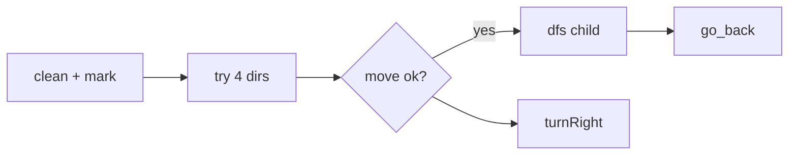

# LC 489. Robot Room Cleaner

> Hard · Premium · [LeetCode](https://leetcode.com/problems/robot-room-cleaner/) · Tags: Backtracking, DFS

## 题意

控制扫地机器人清理所有可达格子。只能调用 `move / turnLeft / turnRight / clean`，不知房间地图与初始朝向。

## 最优思路

相对坐标 DFS：以起点为 `(0,0)`，记录已访问。对四个方向尝试 `move`；成功则递归，返回时 **掉头走一步再掉头**（`go_back`）回到父格子。每次尝试后 `turnRight` 换下一方向。

## 图解

```text
  ↑ d=0
← robot →     visited 相对坐标集合
  ↓
进入子格后返回:
  turnRight×2 → move → turnRight×2
```



## 复杂度

| 项 | 值 |
|----|----|
| 时间 | \(O(\#cells)\) |
| 空间 | \(O(\#cells)\) |

## 代码

见 `489.robot-room-cleaner.py`（含 Mock Robot 本地测试）。
