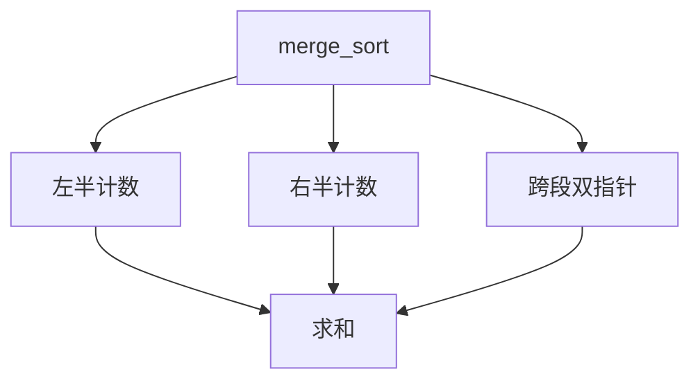

# LC 493. Reverse Pairs

> Hard · [LeetCode](https://leetcode.com/problems/reverse-pairs/) · Tags: Array, Binary Search, Divide and Conquer, BIT, Segment Tree, Merge Sort

## 题意

统计重要翻转对：`i < j` 且 `nums[i] > 2 * nums[j]` 的数量。

## 最优思路

归并排序：左右半部分各自统计后，合并前对左半每个 `left[i]` 统计右半有多少 `right[j]` 满足 `left[i] > 2*right[j]`（双指针），再归并。

## 图解

```text
[1,3,2,3,1]
左[1,3,2] 右[3,1]
跨段: 3>2*1, 2不>2*1 → +1（另有左内对）
总计 2
```



## 复杂度

| 项 | 值 |
|----|----|
| 时间 | \(O(n\log n)\) |
| 空间 | \(O(n)\) |

## 代码

见 `493.reverse-pairs.py`。
